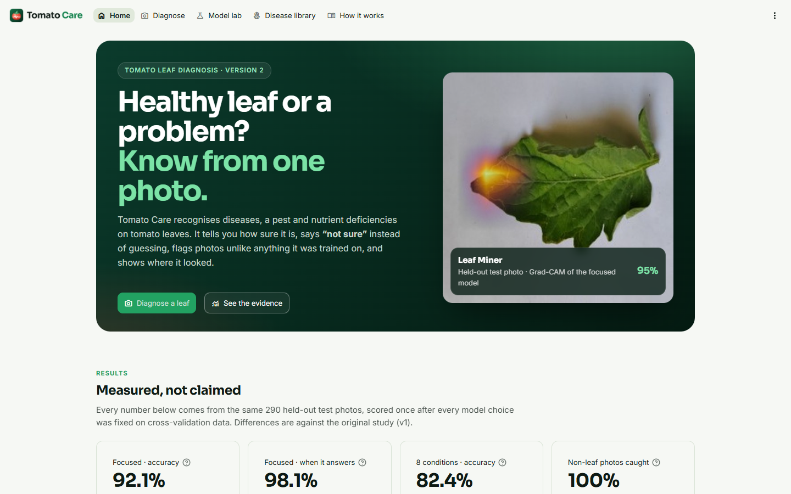
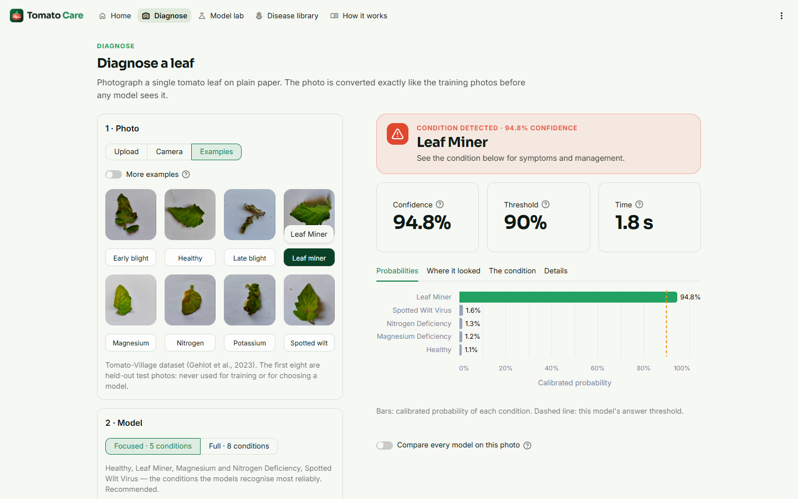
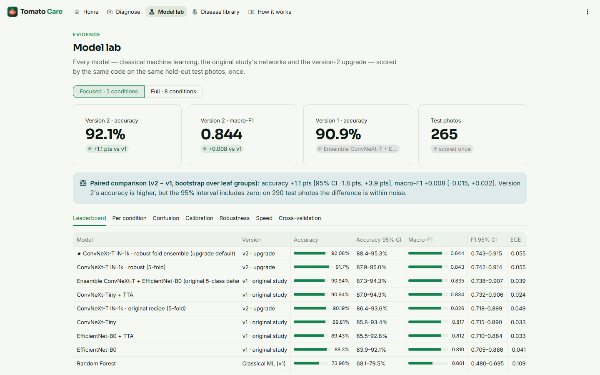
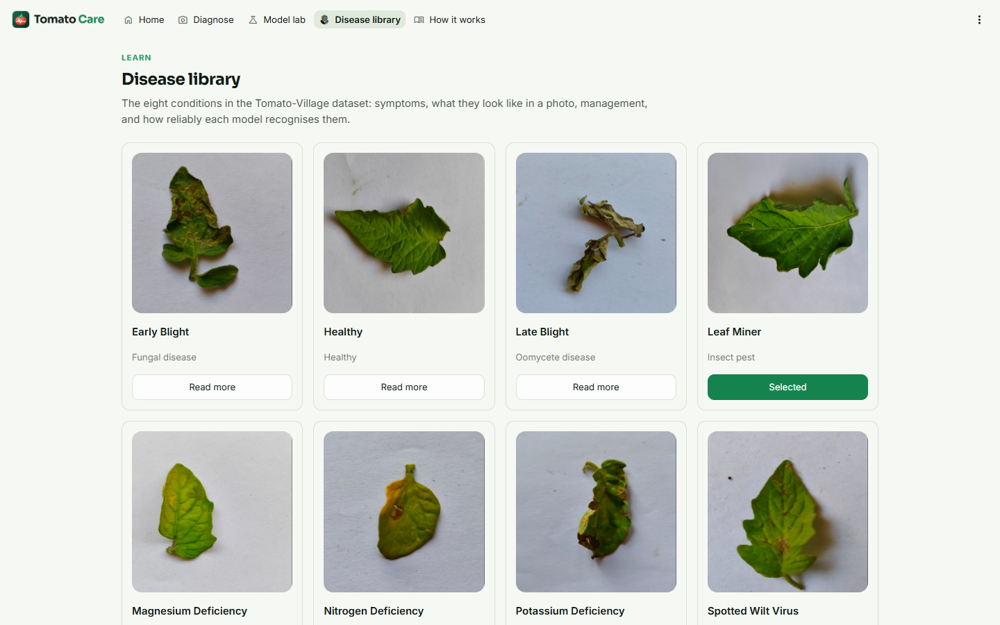
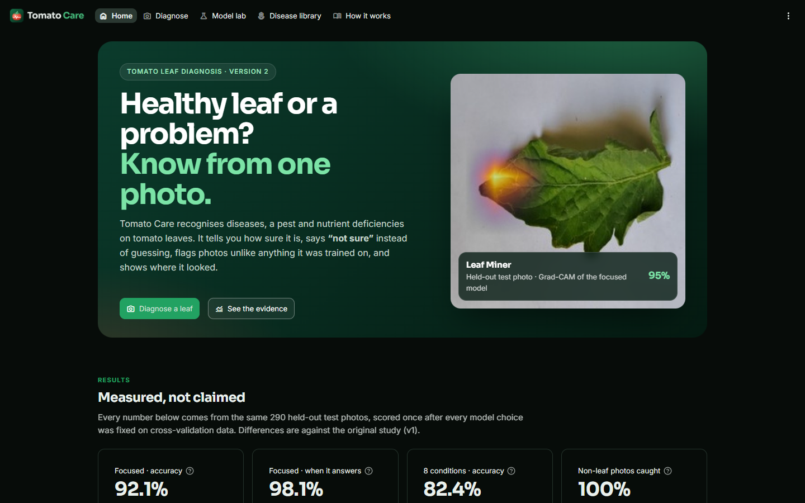
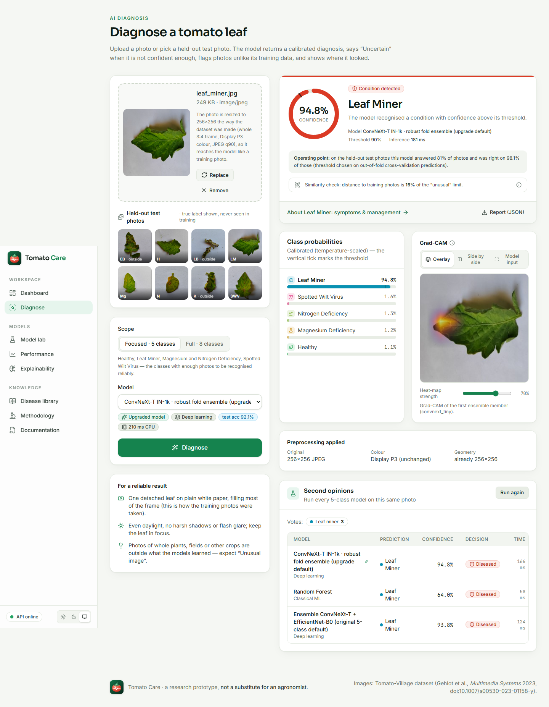
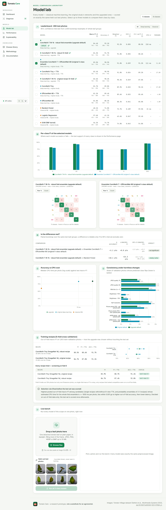

<div align="center">

<picture>
  <source media="(prefers-color-scheme: dark)" srcset="assets/brand/logo-dark.png">
  
</picture>

**Tomato leaf disease diagnosis from a single photo — with calibrated confidence, an honest “not sure”,
an unusual-image check and Grad-CAM explanations, evaluated without data leakage.**

[](https://github.com/CodewithBhaumik/Tomato-Care/actions/workflows/ci.yml)




</div>

## Contents

1. [What it does](#what-it-does)
2. [Results: version 2 against version 1](#results-version-2-against-version-1)
3. [What changed in version 2](#what-changed-in-version-2)
4. [Run it](#run-it) · [Deploy on Streamlit Community Cloud](#deploy-on-streamlit-community-cloud)
5. [Tour](#tour)
6. [How it works](#how-it-works)
7. [Reproducing the experiments](#reproducing-the-experiments)
8. [Project structure](#project-structure)
9. [Limitations](#limitations)
10. [Dataset, citation and licence](#dataset-citation-and-licence)

## What it does

Photograph a single tomato leaf on plain paper. Tomato Care tells you whether it is healthy or which condition it
shows — Early Blight, Late Blight, Leaf Miner, Magnesium / Nitrogen / Potassium Deficiency or Spotted Wilt Virus —
and how sure it is:

| Answer | When |
|---|---|
| **Healthy / Condition detected** | calibrated confidence at or above the model's threshold |
| **Not sure** | confidence below the threshold — no diagnosis instead of a guess |
| **Unusual image** | the photo looks unlike every training photo (not a leaf on paper, another crop, …) |

Every answer comes with the probability of each condition, a Grad-CAM heat map of where the networks looked, the
symptoms and management of the condition, and — on request — the answers of every other model on the same photo.

Two front ends share one prediction engine (`backend/services/predictor.py`):

* **Streamlit app** (`streamlit_app.py`) — the online demo, built for Streamlit Community Cloud: diagnosis, model lab,
  disease library and methodology.
* **React platform + REST API** (`frontend/`, `backend/`) — the full web platform (dashboard, diagnosis studio, model
  lab, performance, explainability, library, methodology, docs) served by FastAPI, as one Docker container.

## Results: version 2 against version 1

All models were scored by the same code on the same **290 held-out test photos** (265 in the focused scope) —
**once**, after every model choice had been fixed on cross-validation data. 95% confidence intervals come from 2,000
bootstrap resamples of whole leaf groups. Full tables: [docs/RESULTS.md](docs/RESULTS.md).

| Task | Model | Accuracy | Macro-F1 | When it answers | Same-leaf consistency |
|---|---|---:|---:|---:|---:|
| **Focused · 5 conditions** (app default) | **v2** — 5-fold ConvNeXt-T ensemble | **92.1%** (88.4–95.3) | **0.844** | answers 81% → **98.1%** correct | **90.5%** |
| | v1 — ConvNeXt-T + EfficientNet-B0 | 90.9% (87.3–94.3) | 0.835 | answers 85% → 96.0% correct | 85.7% |
| **Full · 8 conditions** | v2 — 10-network ConvNeXt-T ensemble | 82.4% (77.7–87.0) | 0.559 | answers 88% → 87.4% correct | 89.1% |
| | v1 — ConvNeXt-T + TTA | **84.8%** (80.1–89.3) | **0.586** | answers 90% → 87.7% correct | **97.8%** |

**Paired differences (v2 − v1, same photos):** focused task accuracy **+1.1 pts** (95% CI −1.8 to +3.9), macro-F1
+0.008 (−0.015 to +0.032); full task accuracy **−2.4 pts** (−5.0 to 0.0), macro-F1 −0.027 (−0.066 to +0.006).
Both intervals include zero: on 290 photos neither difference is statistically reliable.

What this means, without spin:

* **Focused model (the app's default): better than v1 on almost every measure** — accuracy, macro-F1, log-loss and
  Brier score, accuracy when it answers (98.1% vs 96.0%), consistency across re-shots of the same leaf, abstaining on
  conditions it was never trained on (20% vs 12% of such photos), and stability on sRGB phone uploads (1.1% vs 3.0%
  of predictions change). v1 is slightly better calibrated (ECE 0.039 vs 0.055).
* **Full 8-class model: not better than v1.** It was chosen by a rule fixed in advance on out-of-fold data (where it
  ranked first: macro-F1 0.634 vs 0.620 for the original recipe); on the test photos the ranking of these close
  recipes did not hold. Re-choosing after seeing the test results would turn the test set into a tuning set, so the
  pre-registered choice stays and both results are reported. The app offers the v1 model next to it.
* **New in v2:** uploads are converted like the training photos (prediction changes on simulated phone photos fall
  from 2.1–3.5% to 0.0–1.4%, validation), an **unusual-image check** (100% of held-out non-leaf probe images flagged;
  7.9% of normal test photos flagged as the price), and calibrated confidence with an abstention threshold chosen on
  out-of-fold data.
* **95% accuracy on unseen leaves is not reached** for the full task; the leaky official split gives 97.6% for the
  same networks, which measures memorisation of augmented copies (see [Methodology §2](docs/METHODOLOGY.md#2-a-leakage-free-split)).

## What changed in version 2

| Area | Version 1 | Version 2 |
|---|---|---|
| **Upload preprocessing** | centre-crop to a square, colour profile ignored | reproduces how the dataset was made: whole 3:4 frame squashed to 256×256, colour into Display P3, JPEG q90 |
| **Model selection** | one 311-photo validation split (1 Potassium photo) | grouped 5-fold cross-validation on 1,813 photos, fixed-epoch training, pre-registered rule, test scored once |
| **Backbones and recipes** | ConvNeXt-Tiny / EfficientNet-B0 (ImageNet-1k) | + ImageNet-22k ConvNeXt-T, DINOv2 ViT-S/14 and a frozen ViT-B/14 compared in CV; robust recipe (all 8 dihedral views, aspect jitter, JPEG/blur, EMA) |
| **Deployed models** | single checkpoints | fold ensembles: every member has truly held-out data for its calibration and thresholds |
| **Uncertainty** | threshold chosen on 311 photos | temperature scaling + threshold on out-of-fold predictions + **unusual-image** detector (kNN / Mahalanobis feature distance) |
| **Evaluation** | per-model scripts | one benchmark through the app's own predictor: CIs, paired bootstrap, calibration, robustness, same-leaf consistency, CPU latency |
| **Apps** | basic Streamlit demo, 6-page React site | redesigned **Streamlit app** (light/dark, phone layout) and a React platform with 10 pages; new brand |
| **Serving** | all weights in RAM | ONNX Runtime for the API (~1.6–2× faster on CPU); **low-memory mode** for small servers (shared network, memory-mapped float16 weights: 0.9 GB instead of 2.4 GB private RAM, identical outputs) |
| **Engineering** | 28 API tests | 66 tests (library, API, Streamlit pages, weights, low-memory parity), browser checks of both apps, ruff, CI, Docker, release-hosted weights with SHA-256 checks |

## Run it

### Streamlit app (what the online demo runs)

```bash
git clone https://github.com/CodewithBhaumik/Tomato-Care.git && cd Tomato-Care
python -m venv .venv && source .venv/bin/activate      # Windows: .venv\Scripts\activate
pip install -r requirements.txt                          # CPU-only PyTorch on Linux; regular wheels elsewhere
streamlit run streamlit_app.py                           # downloads the weights on first start (1.2 GB, SHA-256 checked)
```

### Docker: REST API + React platform in one container

```bash
docker build -t tomato-care .         # downloads the model weights from the GitHub release (SHA-256 checked)
docker run -p 8000:8000 tomato-care   # open http://localhost:8000  (API docs: /api/docs)
```

### Local API + React development

```bash
pip install torch==2.7.0 torchvision==0.22.0 --index-url https://download.pytorch.org/whl/cpu
pip install -r requirements-train.txt && pip install -e .
python scripts/download_weights.py                        # model weights from the release
uvicorn backend.main:app --port 8000                      # API + docs at http://127.0.0.1:8000/api/docs
cd frontend && npm ci && npm run dev                      # website at http://localhost:5173
```

`curl -F "file=@leaf.jpg" "http://127.0.0.1:8000/api/predict"` — full reference in [docs/API.md](docs/API.md).

| Variable | Default | Meaning |
|---|---|---|
| `TOMATO_RUNTIME` | `onnx` (API), `torch` (Streamlit) | CPU runtime: ONNX Runtime (exported and cached automatically) or PyTorch |
| `TOMATO_LOWMEM` | `0` (API), `1` (Streamlit) | share one network per architecture; weights stay memory-mapped (small servers) |
| `TOMATO_THREADS` | CPUs available | PyTorch CPU threads |
| `TOMATO_LAZY_MODELS` | `0` | API: `1` = load only the default model at startup |
| `TOMATO_DEVICE` | `cpu` | API: `cpu` or `cuda` |
| `TOMATO_DOWNLOAD_WEIGHTS` | `1` | Streamlit: `0` = never download weights (offline, tests) |

## Deploy on Streamlit Community Cloud

1. Sign in at [share.streamlit.io](https://share.streamlit.io) with the GitHub account that owns this repository.
2. **Create app → Deploy a public app from GitHub**: repository `CodewithBhaumik/Tomato-Care`, branch `main`,
   main file `streamlit_app.py`, and an app URL of your choice.
3. **Advanced settings → Python 3.12**, then **Deploy**.

`requirements.txt` installs CPU-only PyTorch; `.streamlit/config.toml` holds the light and dark themes. On first
start the app downloads the weights (1.2 GB, SHA-256 checked) from the
[`weights-v2` release](https://github.com/CodewithBhaumik/Tomato-Care/releases/tag/weights-v2), so the first visit
after a restart takes longer. It runs in low-memory mode (about 0.9 GB of private memory for the two version-2
models) to fit a small server.
`python scripts/30_streamlit_check.py --url https://<your-app>.streamlit.app --no-shots` checks a deployed app in a
real browser.

## Tour

| Streamlit — diagnosis | Streamlit — model lab |
|---|---|
|  |  |
| **Streamlit — disease library** | **Streamlit — dark mode and phone** |
|  |  |
| **React platform — diagnosis studio** | **React platform — model lab** |
|  |  |

## How it works

```
photo ─▶ validate (type, size, decodes) ─▶ EXIF orientation ─▶ colour into Display P3
      ─▶ aspect ratio clamped to 3:4…4:3 ─▶ whole frame resized to 256×256 ─▶ JPEG q90      (= how the dataset was made)
      ─▶ fold ensemble of fine-tuned ConvNeXt-Tiny networks
      ─▶ temperature scaling ─▶ "not sure" threshold ─▶ "unusual image" check (feature-space distance) ─▶ Grad-CAM
```

* **One predictor for everything**: the Streamlit app, the REST API and the offline benchmark call the same
  `ModelRegistry`, so the published numbers are the numbers the apps produce (CPU/GPU, ONNX/PyTorch and low-memory
  paths are checked to agree within 1e-6).
* **Models**: PyTorch; checkpoints store their architecture, input size, normalisation, and the feature statistics of
  their own training photos (for the unusual-image check).
* **Streamlit app**: multipage (`st.navigation`), brand theme for light and dark mode, Altair charts.
* **React platform**: React 19, Vite, Tailwind CSS 4, Recharts, Framer Motion; works read-only from a bundled results
  snapshot when the API is offline.

Details: [docs/METHODOLOGY.md](docs/METHODOLOGY.md) · model card: [docs/MODEL_CARD.md](docs/MODEL_CARD.md).

## Reproducing the experiments

The images are not redistributed (no licence). Download *Variant-a (Multiclass Classification)* of
[Tomato-Village](https://github.com/mamta-joshi-gehlot/Tomato-Village) into `Dataset/Variant-a(Multiclass Classification)/`,
install the GPU build of PyTorch and `requirements-train.txt`, then run the numbered scripts:

| Step | Scripts | Output |
|---|---|---|
| Data audit, leakage-free split | `01`–`04` | `data/index.csv`, `data/splits.csv`, EDA figures |
| Original study (classical ML and CNNs, 5-class scope) | `05`–`10`, `13` | `experiments/results/*.json` |
| Audit of the original models | `19_baseline_audit.py` | `baseline_audit.json` |
| Cross-validation folds and training | `20_make_cv_folds.py`, `21_train_cv.py`, `21b_frozen_features.py` | `experiments/cv/` |
| Model selection on out-of-fold data | `22_select_models.py` | `selection_*.json` |
| Deployment lists, CPU options | `23_build_deployment.py`, `24_cpu_inference.py` | `deployment.json` |
| Final test benchmark (once) | `25_final_benchmark.py` | `final_benchmark.json` |
| Release, app data, report, checks | `26`, `27`, `29`, `28_e2e_check.py`, `30_streamlit_check.py` | weights manifest, `platform.json`, `docs/RESULTS.md` |

Exact commands: [docs/METHODOLOGY.md §9](docs/METHODOLOGY.md#9-reproducing). Tests: `python -m pytest -q`
(66 tests; the ones that need weights or the dataset skip without them).

## Project structure

```
streamlit_app.py       Streamlit entry point (Community Cloud)      streamlit_ui/   its pages, charts, theme
backend/               FastAPI: api/ (routes), services/ (model registry, ONNX Runtime, data store), data/, tests/
frontend/              React platform + public/ (demo photos, Grad-CAM gallery, results snapshot, icons)
src/tomatoleaf/        library: preprocessing, models, training, evaluation, OOD, Grad-CAM, weights download
scripts/               numbered pipeline (01–13 original study, 19–30 upgrade) + brand assets, weights download
tests/                 library, Streamlit, weights and low-memory tests
data/                  derived metadata: index, leaf groups, split, CV folds — no images
experiments/           results JSON, CV summaries, deployment.json, platform.json, weights manifest
assets/brand/          logo and icon sources (scripts/make_brand_assets.py renders every size)
docs/                  methodology, results, model card, API, screenshots
```

## Limitations

* One phone model, two districts of Rajasthan, single leaves on paper: accuracy on field photos, other cameras or
  regions is unknown.
* Potassium Deficiency has 9 photographs in total (2 in the test set) and Nitrogen Deficiency 45: their per-class
  scores are very uncertain; neither default full-task model (v1 or v2) recognises a single Early Blight or
  Potassium Deficiency test photo.
* The test set is small (290 photos): differences of a few points are within noise — read the intervals.
* The same test photos were used to report the original study, so they are not perfectly fresh; no upgrade decision
  used them.
* The unusual-image check catches non-leaf images but few unknown leaf conditions (4% of out-of-scope leaves flagged;
  20% receive no diagnosis once “not sure” is included).
* Grad-CAM shows where a network looked, not why a leaf is diseased.

## Dataset, citation and licence

Images: **Tomato-Village** — Gehlot, M., Saxena, R. K. & Gandhi, G. C. (2023). “Tomato-Village”: a dataset for
end-to-end tomato disease detection in a real-world environment. *Multimedia Systems*.
[doi:10.1007/s00530-023-01158-y](https://doi.org/10.1007/s00530-023-01158-y). The dataset has no declared licence:
it is not included here; the apps show 32 of its photos (demo and held-out test samples) with this citation.

Code: MIT licence (see [LICENSE](LICENSE)). Disease information summarises the extension sources cited in
`backend/data/disease_info.json`. Tomato Care is a research prototype — **not** a substitute for an agronomist or a
plant-health laboratory.
